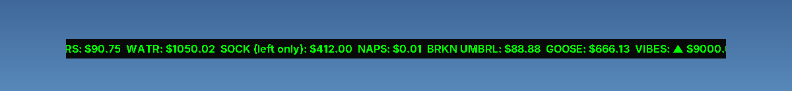

<div align="center">
  <h1>📈 Fake Trade Ticker</h1>
  <p><b>A scrolling desktop stock ticker for things that aren't stocks, like eggs, geese and one left sock.</b></p>

  <p>
    <a href="#-features">Features</a> •
    <a href="#-controls">Controls</a> •
    <a href="#-getting-started">Getting Started</a> •
    <a href="#-customizing">Customizing</a> •
    <a href="#-contributing">Contributing</a>
  </p>

  <!-- Badges -->
  <p>
    
    
    
    
  </p>
</div>

---

## 🎥 See It in Action

<div align="center">
  
</div>

---

## ✨ Features

- **📜 Scrolling Ticker:** Green, news-channel-style text that scrolls across a dark strip at the bottom of your screen.
- **🥚 23 Very Real Assets:** EGGS, GOOSE, VIBES ▲, MONDAY ▼, WET SOCK (trading below zero), and more.
- **🖱️ Move It Anywhere:** Borderless window you can drag around the screen and resize from its left or right edge.
- **⏯️ Restart & Pause:** Restart the scroll or pause it with a key or from the right-click menu.
- **🪶 Lightweight:** One Java file, no dependencies, nothing to install besides Java.

---

## 🎛️ Controls

| Action | How |
| --- | --- |
| Move the ticker | Click and drag it |
| Make it wider or narrower | Drag its left or right edge |
| Open the menu | Right-click the ticker |
| Restart the scroll | **R**, or **Restart** in the menu |
| Pause / resume | **Space**, or **Pause / Resume** in the menu |
| Put it back at the bottom | **Snap to Bottom** in the menu |
| Stretch it across the screen | **Full Width** in the menu |
| Center it at half size | **Half Width (centered)** in the menu |
| Quit | **Esc**, or **Exit** in the menu |

The text scrolls through once and then stops. Press **R** to run it again.

---

## 🛠️ Tech Stack

- **Language:** Java (8 or newer)
- **UI:** Swing (`JFrame`, `JLabel`, `JPopupMenu`)
- **Animation:** `javax.swing.Timer` moving the label 2 pixels every 50 ms
- **See-through window:** Borderless `JFrame` with a partly transparent background

---

## 🚀 Getting Started

### Prerequisites

[Java](https://adoptium.net/) 8 or newer. Check with:

```bash
java -version
```

### Option 1: Download and run

Download `FakeStockTicker-v1.0.0.jar` from the [Releases page](https://github.com/Rubyduzstuff/Fake-Trade-Ticker/releases), then run:

```bash
java -jar FakeStockTicker-v1.0.0.jar
```

### Option 2: Build from source

1. **Clone the repository:**
   ```bash
   git clone https://github.com/Rubyduzstuff/Fake-Trade-Ticker.git
   ```
2. **Go into the folder:**
   ```bash
   cd Fake-Trade-Ticker
   ```
3. **Compile:**
   ```bash
   javac FakeStockTicker.java
   ```
4. **Run:**
   ```bash
   java FakeStockTicker
   ```

---

## 🎨 Customizing

Everything lives in `FakeStockTicker.java`:

| To change | Edit |
| --- | --- |
| The entries | The list in `tickerText` at the top of the class |
| Scroll speed | `scrollSpeed` (pixels per step) or `delay` (milliseconds between steps) |
| Text color and font | `tickerLabel.setForeground(...)` and `tickerLabel.setFont(...)` |
| Background darkness | The last number in `setBackground(new Color(10, 10, 10, 220))`: 255 is solid black, lower is more see-through |

---

## 🤝 Contributing

Got a sillier asset than WET SOCK? Contributions are welcome.

1. Fork the repository
2. Create a branch: `git checkout -b my-silly-idea`
3. Commit your changes: `git commit -m "Add LLAMA futures"`
4. Push the branch: `git push origin my-silly-idea`
5. Open a pull request

---

<div align="center">
  <sub>Not financial advice. Please do not invest in GOOSE.</sub>
</div>
